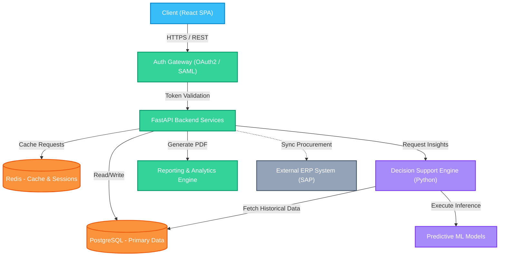

# System Architecture

The DPM-DSS utilizes a modern, decoupled architecture designed for high availability, security, and scalability. 

## Architectural Flow

## Component Breakdown

### 1. React Frontend
- **Technology**: React 18, Vite, Tailwind CSS, TanStack Query, Recharts.
- **Responsibility**: Provides the responsive, interactive user interface. Handles local state management, caching of network requests, and renders advanced SVG charts.

### 2. FastAPI Backend Services
- **Technology**: Python, FastAPI, SQLAlchemy, Pydantic.
- **Responsibility**: Serves as the core API gateway. Handles business logic, RBAC (Role-Based Access Control) enforcement, data validation, and routes requests to the AI engine or database.

### 3. Decision Support Engine
- **Technology**: Python, scikit-learn, Pandas.
- **Responsibility**: Analyzes schedule and cost variances (SPI/CPI) to predict project delays and budget overruns. Generates actionable recommendations based on historical DRDO project data.

### 4. PostgreSQL Database
- **Technology**: PostgreSQL 15.
- **Responsibility**: Acts as the single source of truth for all projects, milestones, users, audit logs, and financial records. Includes strict schema validations and encrypted at rest.

### 5. Reporting & Analytics
- **Technology**: Puppeteer (or equivalent PDF generator), Pandas.
- **Responsibility**: Aggregates complex portfolio data to generate static, immutable PDF reports for executive briefings.
